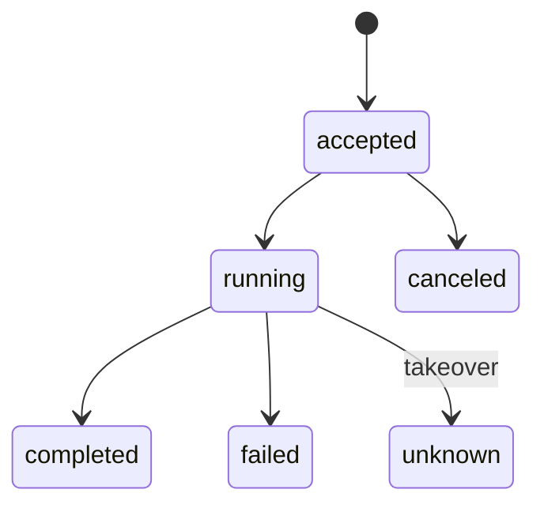
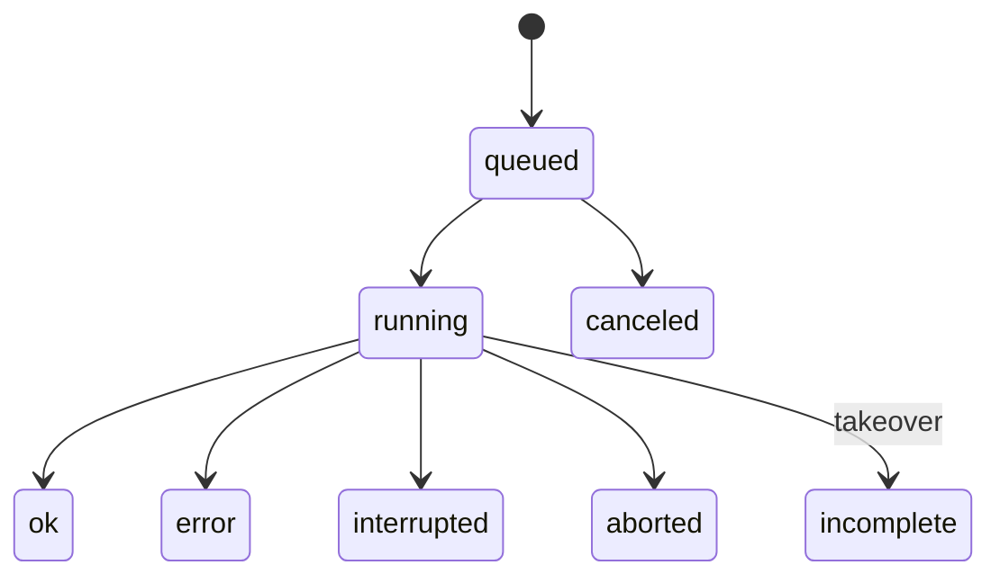
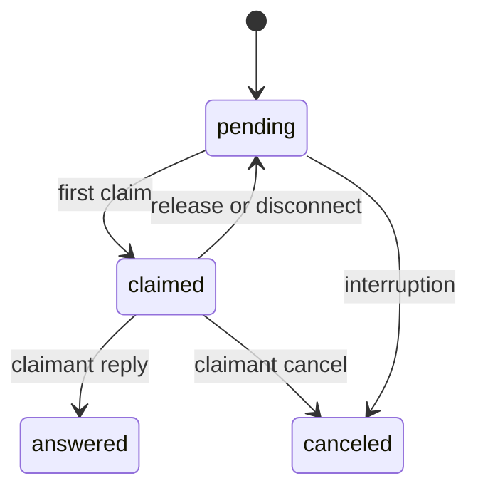

# Desktop protocol 1

Four-byte big-endian lengths prefix UTF-8 JSON objects, capped at 1 MiB. A `blob`
header is followed by exactly `byte_size` binary bytes, capped at 1 MiB per chunk.
Desktop and legacy listeners use separate ports. The offline helper uses binary
stdio and never starts a worker, writes the ledger or executes notebook code.

`hello` names API `kernelledger.desktop`, versions, stable client UUID, display
name and role; supervisor connections also supply the project token. `welcome`
declares capabilities, ledger schema and a per-start `instance_id`.

Persist `client_request_id` before sending a side effect. After losing a reply,
look up that key with `operation.get`, even after source edits. Reusing it with
different semantic content yields `key_reused`. Transport `request_id` is excluded
from durable request hashes. Never choose a fresh key to discover an outcome.

`completed` includes domain outcomes such as errored executions or refused
checkpoints. `unknown` is never success. Frozen batches run contiguously;
stop-on-error cancels remaining work. Worker abortion always stops a batch.

Subscriptions return a snapshot/watermark or replay after a cursor. Frames use
`kind: change`, `change_kind` for the domain transition, and monotonic `change_seq`.
Execution events use `(exec_id, seq)`. Deduplicate cursors. Separate read-only
SQLite readers ensure only committed events stream. On `resync_required`, page
`changes.list`; reconcile output using helper `fold.get`.

Source writes carry expected manifest/cell revisions. A lost source reply requires
a re-read and content comparison. Source errors do not prevent history inspection.
Migration is explicit and backs up schema 1. Desktop migration bootstraps schema
2 before recording its operation and answering; repeating it is idempotent.

`scripts/desktop_contracts.py` generates schemas from the stdlib request catalog.
Python and Rust consume shared frames in `tests/fixtures/desktop/`.
See [coverage](desktop/coverage.md) for outstanding stress and payload gates.

CLI-only entry points are initial `init`/`serve`, stale-registry pruning, explicit
id repair, and local descriptor `fetch` (desktop uses `descriptor.inspect`).
Execution, history and sharing groups have supervisor/helper counterparts;
retargeting and structural editing use the source service.
